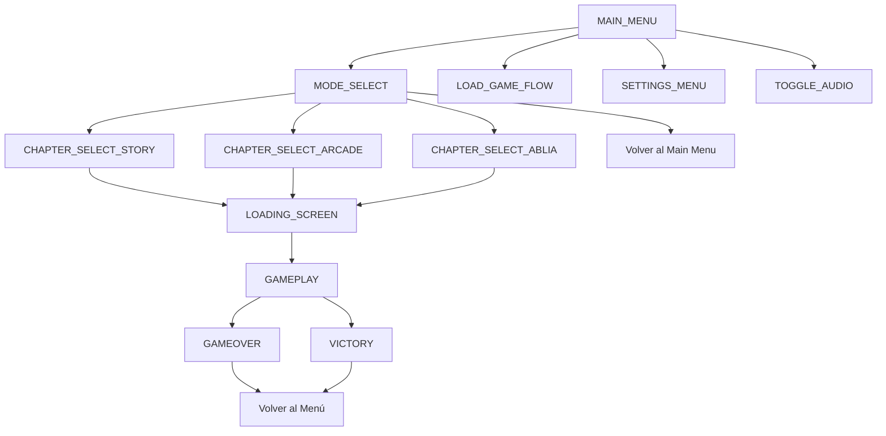

# XANEZU CATCH - Navigation Tree & State Map

Este documento define la estructura oficial de navegación y los estados internos del motor de juego, según la arquitectura **100% Canvas**.

---

## 🌳 Árbol de Navegación

---

## 📋 Lista de Estados Oficiales (IDs Reales)

| Estado ID | Descripción | Pantalla / Contexto |
| :--- | :--- | :--- |
| `main_menu` | Menú principal de entrada | Pantalla de inicio con 4 botones core. |
| `mode_select` | Selector de modo de juego | Elección entre Historia, Arcade y ABLIA. |
| `settings_menu` | Configuración técnica | Exportación e Importación de partidas. |
| `chapter_select_story` | Selector de niveles Historia | 8 tarjetas paginadas (Campaña). |
| `chapter_select_arcade` | Selector de niveles Arcade | 8 tarjetas paginadas (Desafío). |
| `chapter_select_ablia` | Selector ABL e IA | 8 tarjetas paginadas (Modo Adaptativo). |
| `loading_screen` | Pantalla de carga | Transición y precarga de assets. |
| `gameplay` | Estado activo de juego | El loop principal donde ocurre la acción. |
| `load_game_flow` | Flujo de carga de guardado | Gestión de slots de memoria. |

---

## 🔄 Mapa de Transiciones Críticas

1. **Nueva Partida**: `main_menu` -> `mode_select` -> `chapter_select_*` -> `loading_screen` -> `gameplay`.
2. **Ciclo de Muerte**: `gameplay` -> `gameover` -> `main_menu`.
3. **Guardado**: `gameplay` (Auto) -> `save_system`.
4. **Configuración**: Accesible desde `main_menu`.

---

> [!IMPORTANT]
> Toda la navegación se realiza mediante el método `game.stateManager.navigate('state_id')`. Quedan terminantemente prohibidos los enlaces `<a>`, redirecciones de URL o manipulación del DOM.
