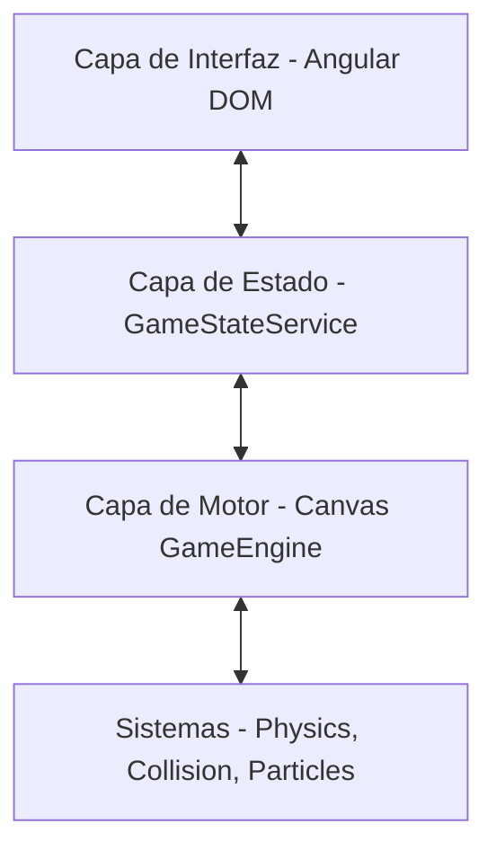

# Arquitectura del Sistema

La arquitectura de **Xanezu Catch** es una estructura híbrida dividida en capas bien delimitadas para garantizar la mantenibilidad y escalabilidad del código.

## Capas del Sistema

1. **Capa de Interfaz (UI Layer)**:
   - Implementada en **Angular 21** mediante HTML y Vanilla CSS.
   - Maneja menús, selección de capítulos, pantallas de fin de juego (Game Over / Victoria) y el HUD superior del gameplay.

2. **Capa del Gestor de Estado (Core)**:
   - Centralizada en `GameStateService`.
   - Utiliza reactividad moderna con Angular Signals y BehaviorSubjects de RxJS.
   - Actúa como la única fuente de verdad para la navegación y estado global del juego (XP, gemas, progreso de carga).

3. **Capa del Motor del Juego (Canvas & Engine)**:
   - Escrita en TypeScript puro.
   - Encapsulada dentro del componente Angular `GameCanvasComponent`.
   - Controla el bucle de renderizado (`requestAnimationFrame`), inicialización del canvas y carga de assets a través de `AssetLoader`.

4. **Sistemas Especializados**:
   - Lógica de físicas, detección de colisiones, simulación de partículas y sintetizador de audio en tiempo real (`MusicSynth`).\n