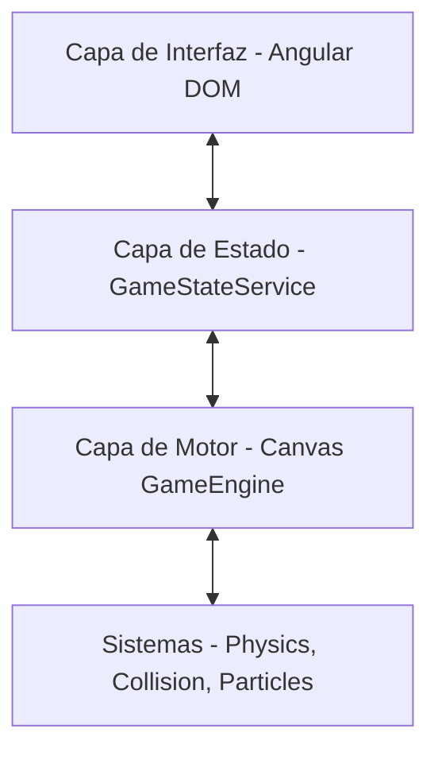

# Arquitectura del Sistema

La arquitectura de **Xanezu Catch** es una estructura híbrida dividida en capas bien delimitadas para garantizar la mantenibilidad y escalabilidad del código.

## Capas del Sistema

1. **Capa de Interfaz (UI Layer)**:
   - Implementada en **Angular 21** mediante HTML y Vanilla CSS.
   - Maneja menús, selección de capítulos, pantallas de fin de juego (Game Over / Victoria) y el HUD superior del gameplay.

2. **Capa del Gestor de Estado (Core)**:
   - Centralizada en `GameStateService`.
   - Utiliza reactividad moderna con Angular Signals y BehaviorSubjects de RxJS.
   - Actúa como la única fuente de verdad para la navegación y estado global del juego (XP, gemas, progreso de carga).

3. **Capa del Motor del Juego (Canvas y Engine)**:
   - Escrita en TypeScript puro, desacoplada en subsistemas especializados (< 300 líneas por módulo).
   - Encapsulada dentro del componente Angular `GameCanvasComponent`.
   - Controla el bucle de renderizado (`requestAnimationFrame`), orquestación del ciclo de vida y eventos del juego (`GameEngine`).
   - `SceneRenderer`: Pipeline de renderizado Canvas 2D desacoplado (cumplimiento estricto de fondos fijos en Story e interpolación ABLIA).
   - `AssetLoader`: Carga asíncrona de recursos con caché y telemetría de progreso.

4. **Sistemas Especializados y Renderizadores**:
   - `InputController`: Manejo aislado de eventos de teclado, ratón y touch con limpieza garantizada en el ciclo de destrucción.
   - `ItemEffectSystem`: Lógica de recolección, efectos de combos (bananas, chuches, vida extra), power-ups y multiplicadores temporales.
   - `PhysicsSystem` y `CollisionSystem`: Físicas cinemáticas, atracción magnética y detección de colisiones AABB con tolerancia de hitboxes.
   - `DirectorSystem`: Generación procedimental de oleadas, coleccionables y obstáculos escalados por nivel y dificultad.
   - `BiomeRenderer`, `AbliaRenderer`, `AbliaPrimitives` y `AbliaThemes`: Renderizado por biomas clásicos y 16 civilizaciones procedimentales.
   - `ParticleSystem`: Simulación optimizada de partículas visuales.
   - `MusicSynth`: Sintetizador WebAudio procedimental unificado en un único `AudioContext`.\n