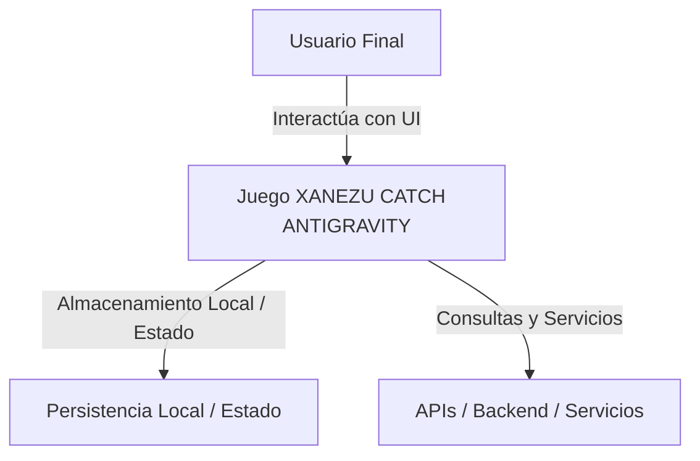

# ARQUITECTURA DEL SISTEMA Y DIAGRAMA C4

## 1. VISTA DE CONTEXTO (NIVEL 1 C4)
El sistema **Juego XANEZU CATCH  ANTIGRAVITY** opera como núcleo de procesamiento e interfaz, comunicándose con servicios periféricos y almacenamiento.

## 2. VISTA DE CONTENEDORES (NIVEL 2 C4)
- **Capa de Presentación:** Interfaz de usuario basada en componentes reactivos y estilos adaptativos.
- **Capa Lógica:** Manejo de estado, controladores de eventos y algoritmos de negocio.
- **Capa de Datos:** Modelos de datos, validación y gestión de persistencia.
